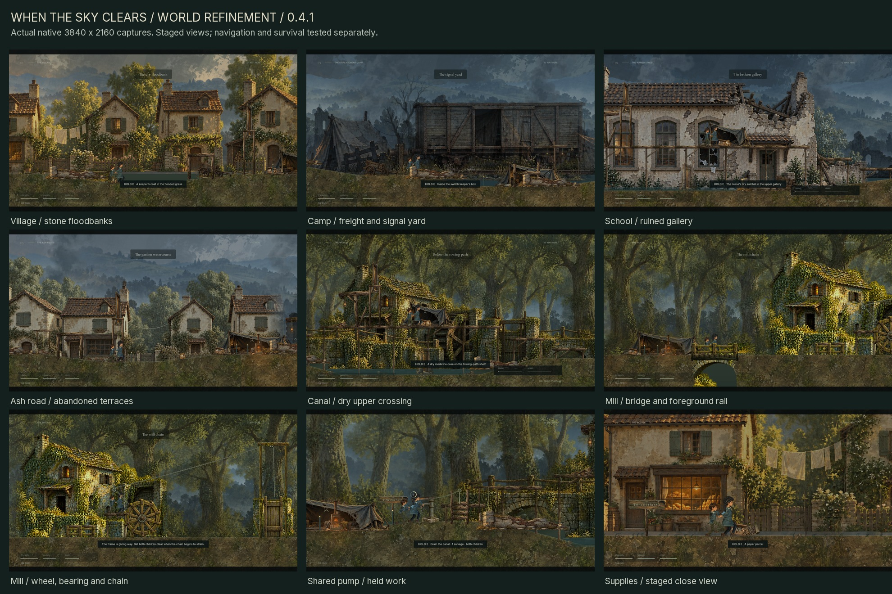

# When the Sky Clears

A painted, side-scrolling survival game about two children holding on to each other through displacement, ruined places, and the first signs of renewal.

Guide the older child, keep her companion close, and find shelter for both. Environmental problems and survival decisions shape the route: climb a machine to set it moving, find a dry way above a listening post, or save a scarce piece of salvage and cross cold water quietly. Food, warmth, medicine, and salvage are finite. Low cover requires crouching; exposed crossings require timing. Shared lifting, searching, repairs, and rest take time while the world keeps moving.



## Play

Download the verified [v0.4.1 Windows ZIP](https://github.com/SingSongScreamAlong/WhenTheSkyClears/releases/download/v0.4.1/When_The_Sky_Clears_Windows_v0.4.1.zip) or [editable-source ZIP](https://github.com/SingSongScreamAlong/WhenTheSkyClears/releases/download/v0.4.1/When_The_Sky_Clears_Editable_Source_v0.4.1.zip). Extract a Windows package and run **When the Sky Clears.exe**; standalone play needs neither Godot nor Python. Source opens in Godot 4.6 Standard. The preserved [v0.4.0 Windows ZIP](https://github.com/SingSongScreamAlong/WhenTheSkyClears/releases/download/v0.4.0/When_The_Sky_Clears_Windows_v0.4.0.zip) and [source ZIP](https://github.com/SingSongScreamAlong/WhenTheSkyClears/releases/download/v0.4.0/When_The_Sky_Clears_Editable_Source_v0.4.0.zip) remain available.

Use [`game/PLAY.cmd`](game/PLAY.cmd) to launch the full journey from a prepared checkout. [`game/MILL_PLAYTEST.cmd`](game/MILL_PLAYTEST.cmd) opens the mill directly in an isolated, unsaved playtest (`-- --mill-preview`). [`game/FREIGHT_CROSSING.cmd`](game/FREIGHT_CROSSING.cmd) opens a separate freight rehearsal (`-- --freight-crossing`) combining supply searches, shelter, stealth, traversal, and shared work. Its own save keeps the main journey intact. Normal campaign progress uses `journey_v4.json` in the separate `WhenTheSkyClears/v040` Godot user-data directory; earlier saves are preserved.

[`game/CANAL_PLAYTEST.cmd`](game/CANAL_PLAYTEST.cmd) (`-- --canal-preview`) starts an isolated, unsaved canal approach with no salvage. Search the existing tool roll before choosing between the pump and raised route. The full campaign remains compatible with v0.4.0 saves.

**On macOS:** install Godot 4.6 stable Standard, import `game/project.godot`, and run with F5. Python, .NET, Windows executables, and external runtime asset downloads are unnecessary for editor play. See [macOS setup and verification limits](docs/MACOS.md); a Mac runtime test is not claimed here.

The current build uses Godot's Vulkan Mobile renderer. The source checkout contains editable game assets and code; packaged executables are distributed through Releases.

| Keyboard | Action |
| --- | --- |
| A / D or arrow keys | Move |
| Space / W / Up | Jump |
| Shift | Run |
| S / Down | Crouch |
| Hold E | Search, work, or rest |
| Hold E + move against a crate | Push |
| Q | Ask the companion to wait low / call him |
| H | Use medicine |
| Tab | Pack and objective |
| R | Recover at the checkpoint |
| Esc / F11 / M | Pause / fullscreen / mute |

Controller: left stick or D-pad to move, A to jump, B to crouch, hold X to work, Y to wait/call, RB to run, Back for the pack, and Start to pause.

## Development pass 0.4.1

Six new painted props give supplies and work their own materials: a ration box, medicine satchel, canvas tool roll, pump body, separate lever, and lantern. Partially searched caches show what remains; picking up medicine leaves food visible when the pack cannot hold it. The pump lever moves at its bearing toward the working hands, and its sluice rises with the receding water. Shared lifts, clearing and bracing have local work movement, with warmer lantern light at braces.

School, railway and ash regions use more distinct architectural staging. Cleaner banks, bridge edges and foreground foliage leave room to read the route. The mill refines its painted crop registration, chain, bearing and breakaway debris while retaining the connected physical problem.

Five chapters travel from the village through woods, a camp and railway station, a flooded school, and an ash garden. The authored route now spans **79,200 world units**, up from 56,000. Two new physical forks offer distinct paths through the woods canal and school arcade: stay low and quiet in cold water, spend one salvage on a shared pump, or climb above the listening lane and spend salvage to secure the upper passage. Dry food and medicine reward the high route; both children must get through it.

The woods mill connects its bridge, climbable fence, breakaway wheel, tether, and blocked gate into one physical encounter. A child standing on the wheel loads the frame. Its warning gives both children time to retreat before the wheel breaks free and rolls. The wheel's actual travel raises the gate; an interaction button cannot skip the sequence. A child left ahead of it can be hurt.

Eighteen timed hazard lanes, including two sound-sensitive listening posts, join shared lifts, debris clearing, optional braces, shelter repairs, moving lights, and crosswinds. The pack holds four food portions, three salvage pieces, and two medicines. World caches are finite, and optional rewards compete with the time, effort, and supplies spent reaching them. These are authored interactive situations; the game does not claim that every painted object is interactive.

The children retain drawn silhouettes, articulated limbs, planted feet, companion gestures, cloth follow-through, and collision-aware climbing. Work now interrupts when the child leaves its height, releases the action, or loses the required companion. Pause holds work, the lever and the water transition. The earlier crouch, head-clearance, turn and sloped-foot refinements remain.

The painted tent's material clarity remains the benchmark for characters, props and terrain. Faces and clothing retain their earlier painted detail and material treatment; this pass develops interaction props and staging around them. Final rendered review and artistic acceptance remain separate from functional test results.

The [v0.4.1 review board](game/evidence/v041/V041_PLAYABLE_REVIEW.jpg) presents selected views from 12 native 4K captures, including staged pump-work and supply close views. The [18-second mill playthrough](game/evidence/v041/WTSC_Mill_Playthrough_v041.mp4) records native input and physics after its explicit starting fixture. The retained [v0.4.0 art comparison](game/evidence/v040/ART_READABILITY_BEFORE_AFTER.jpg) documents the previous pass. Original artwork and recorded ImageGen prompts remain preserved.

This is an evolving development build, **not a finished commercial game or an achieved AAA quality target**. Bespoke acting, animation transitions, terrain and prop craft, encounter depth, sound design, and human balancing remain active work.

Read the [changes and controls](game/DEVELOPMENT_v0.4.1.txt), [retained chapter design](game/JOURNEY_v0.4.0.txt), and [v0.4.1 release notes](docs/releases/v0.4.1.md). The [verified v0.4.0 notes](docs/releases/v0.4.0.md) remain available.

## Edit and build

1. Install **Godot 4.6 Standard** and import [`game/project.godot`](game/project.godot).
2. Run the project with F6 from `scenes/main.tscn`, or F5 for the project.

Editor play needs no export templates. To build the Windows package with the portable tools, run these commands from the repository root:

```sh
python game/tools/setup_godot.py
python game/tools/build_v041.py export
```

The setup helper downloads the official editor and Windows export templates and checks their recorded SHA-512 values. The export helper temporarily selects those portable templates for the Windows export, restores the preset's empty custom-template fields, then records the source and executable identity. Python is needed for development helpers, not for the game itself. Downloaded engines and generated import caches are not committed.

For manual editor or command-line exports, install matching Godot 4.6 export templates through the editor. The checked-in preset keeps its custom-template fields empty. Example commands with `godot` pointing to your editor:

```sh
godot --editor --path game
godot --headless --path game --import
godot --headless --path game --export-release "Windows Desktop" /absolute/output/WhenTheSkyClears.exe
```

Create the output directory before a manual export. See the [repository guide](docs/REPOSITORY.md) for the Windows workflow and evidence index, and [`game/SOURCE_SETUP.txt`](game/SOURCE_SETUP.txt) for the previously distributed source-package notes.

## Project layout

| Path | Contents |
| --- | --- |
| `game/scripts/` | Character controller, survival, encounters, rendering, HUD, and QA scenarios |
| `game/levels/` | Five authored JSON chapters |
| `game/scenes/` | Native Godot scenes |
| `game/assets/` | Runtime paintings, characters, props, motion data, fonts, and audio |
| `game/tools/` | Setup, level-authoring, packaging, and verification helpers |
| `game/previous/` | Preserved prior source and level data used by development tools |
| `game/evidence/` | Selected reports, manifests, and visual reviews |
| `docs/` | Repository setup, original story reference, and asset-source documentation |

## Verification

The final v0.4.1 executable passed **386 native functional checks**, including 15 new interaction checks. A separate **27-check source animation fixture** passed against the frozen source; it includes baseline movement checks and stays outside the native total. Continuous navigation completed **all five chapters in 730.45 simulated seconds**, with **one checkpoint recovery**. This is an automated route result, not measured human playtime.

The build identity freezes **143 runtime files**. All **12 fresh native 3840 × 2160 captures** passed verification. The silent mill movie fully decoded at **1440 × 810, 30 fps, 540 frames / 18 seconds**; its [validation record](game/evidence/v041/mill_movie_validation.json) binds the recording invocation. The safe crossing begins after explicit fixture setup; risk and pause are tested separately. Exact invocations and fresh output hashes are under `game/evidence/v041/release_final/`, with selected results in `DELIVERY_MANIFEST_v041.json`. Targeted fixtures, campaign navigation and staged views have separate scopes. No new offline terrain audit is claimed.

The preserved [v0.4.0 manifest](game/evidence/v040/DELIVERY_MANIFEST_v040.json) records 371 native checks, its separate 27-check source fixture, and full-journey completion in 730.45 simulated seconds with one checkpoint recovery. Those results and its nine captures, 18-second mill movie and terrain audit belong to v0.4.0. Automated traversal times are not measured human playtime.

Run source scenarios into separate v0.4.1 evidence tags:

```sh
python game/tools/build_v041.py test refinement-checks --source --tag source_refinement
python game/tools/build_v041.py test movement-checks --source --tag source_movement
python game/tools/build_v041.py test smoke survival --source --tag source_survival
```

[`build_v041.py`](game/tools/build_v041.py) provides independent `export`, `test`, `verify`, and `package` operations. After export, use `test all`, then `test capture`; `verify` writes nothing, and `package` writes separate v0.4.1 ZIPs. Source checks use `test <kind> --source --tag <name>`. The final capture flag is `--capture-v041`. All runtime source, assets and UID sidecars are hashed. Automated checks and rendered captures do not establish artistic acceptance or replace human playtesting.

The earlier v0.4.0 helpers and artifacts are retained for their recorded versions. Use the v0.4.1 helper for this pass to keep its output separate.

## Artwork and licenses

See [asset sources and provenance](docs/ASSET_SOURCES.md). Runtime assets retain their available source receipts and third-party licenses. Kenney footsteps are CC0; bundled fonts retain their SIL Open Font Licenses; Godot is MIT licensed. Quaternius models and animation were acquired as development references; the raw vendor archives and unused 3D reference libraries are not redistributed as part of the playable game's source tree.

Generated paintings include their recorded prompts and provenance beside the assets, including the [new six-prop interaction atlas](game/assets/props/Interaction_Props_PROVENANCE_v041.json), [canal layer](game/assets/environments/Canal_PROVENANCE_v040.txt), [mill background](game/assets/environments/Mill_Background_PROVENANCE_v040.txt), [separate mill parts](game/assets/props/Mill_Parts_PROVENANCE_v040.txt), [railway layer](game/assets/environments/Rail_Yard_PROVENANCE_v030.txt), and [survival prop atlas](game/assets/props/PROVENANCE_v020.txt).

No blanket open-source license is granted for this repository. Rights to original game code, story, and artwork remain with their owner; third-party materials retain their own license terms.
