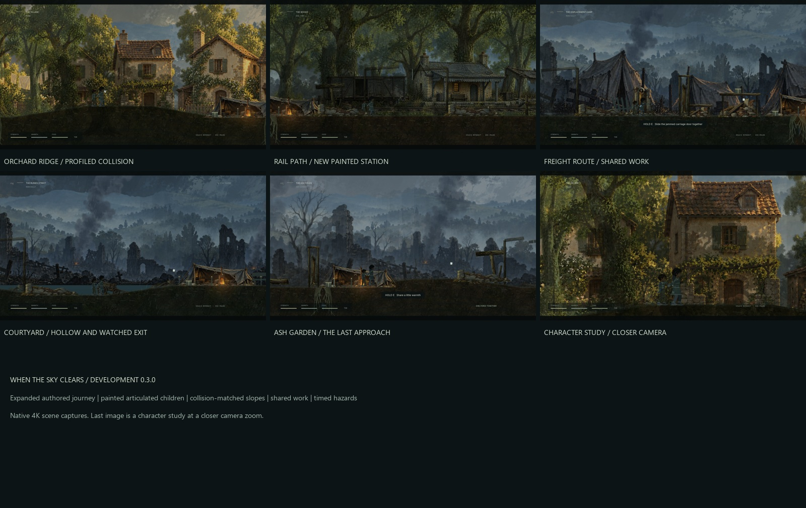

# When the Sky Clears

**On macOS:** clone this repository, install **Godot 4.6 stable Standard**, and
import **`game/project.godot`** in Godot's Project Manager. Run the project with
F5. See [macOS setup and verification limits](docs/MACOS.md). No Windows build,
Python, .NET, or external runtime asset download is required.

**Current development checkpoint: 0.5.0 on `dev/last-house-before-crossing`.**
The Last House title option adds painted house exploration, shop/arcade choices,
reciprocal passage help, pair cover and individual exposure feedback, then a dry
room with shared food and quiet playable relief. See [route notes and remaining
polish](game/DEVELOPMENT_v0.5.0.txt) and [native verification](game/evidence/v050/CHECKPOINT_MANIFEST.json).
The full five chapters and freight rehearsal remain available. This branch
preserves the earlier reliability fixes; main is not merged with this checkpoint.
On Mac, clone this development branch as shown in [setup](docs/MACOS.md), import
`game/project.godot` and run with F5. On Windows use `game/PLAY.cmd` or
`game/LAST_HOUSE.cmd` when working in this checkout.

The isolated **0.4.0 development pass** adds equal-height character collision,
head clearance while crouching, more stable companion following, and a freight
crossing rehearsal combining supplies, shelter, stealth, traversal and shared
work. Run `game/PLAY.cmd` or `game/FREIGHT_CROSSING.cmd` in this checkout. Read
[the pass notes](game/DEVELOPMENT_v0.4.0.txt) and
[its exact verification manifest](game/evidence/v040/DELIVERY_MANIFEST.json).
The original 0.3.0 documentation and history below remain as provenance.

A painted, side-scrolling survival game about two children holding on to each other through displacement, ruined places, and the first signs of renewal.

Guide the older child, keep her companion close, and find shelter for both. Food, warmth, medicine, and salvage are finite. Low cover requires crouching; exposed crossings require timing. Shared lifting, searching, repairs, and rest take time while the world keeps moving.



## Play

Download **When_The_Sky_Clears_Windows_v0.3.0.zip** from the [v0.3.0 release](https://github.com/SingSongScreamAlong/WhenTheSkyClears/releases/tag/v0.3.0), extract it, and run **When the Sky Clears.exe**. The standalone Windows build does not require Godot or Python.

The current build uses Godot's Vulkan Mobile renderer. The source checkout contains editable game assets and code; packaged executables are distributed through Releases.

| Keyboard | Action |
| --- | --- |
| A / D or arrow keys | Move |
| Space / W / Up | Jump |
| Shift | Run |
| S / Down | Crouch |
| Hold E | Search, work, or rest |
| Hold E + move against a crate | Push |
| Q | Ask the companion to wait low / call him |
| H | Use medicine |
| Tab | Pack and objective |
| R | Recover at the checkpoint |
| Esc / F11 / M | Pause / fullscreen / mute |

Controller: left stick or D-pad to move, A to jump, B to crouch, hold X to work, Y to wait/call, RB to run, Back for the pack, and Start to pause.

## Development build 0.3.0

Five chapters travel from the village through woods, a camp and railway station, a flooded school, and an ash garden. The authored route spans 56,000 world units, with six optional elevated supply routes. New situations include a broken crossing, shared barrier lifts, moving searchlights, falling masonry, roof bracing, crosswinds, and pumping a flooded yard.

The characters use drawn silhouettes, articulated limbs, planted feet, companion gestures, cloth follow-through, and collision-aware climbing. Layered paintings, foreground cover, and terrain profiles form the world.

This is an evolving development build, **not a finished commercial game or an achieved AAA quality target**. Bespoke acting, animation transitions, terrain and prop craft, encounter depth, sound design, and human balancing remain active work.

Read the [changes and controls](game/DEVELOPMENT_v0.3.0.txt) and [chapter design](game/JOURNEY_v0.3.0.txt).

## Edit and build

1. Install **Godot 4.6 Standard** and import [`game/project.godot`](game/project.godot).
2. Run the project with F6 from `scenes/main.tscn`, or F5 for the project.
3. Run the setup helper below to install the portable Windows export templates used by the included **Windows Desktop** preset. Alternatively, clear the preset's two custom-template fields and install matching templates through Godot.

The Windows setup helper, [`game/tools/setup_godot.py`](game/tools/setup_godot.py), downloads the official editor and export templates and verifies their recorded SHA-512 checksums. Run `python game/tools/setup_godot.py` from the repository root. Python is needed for development helpers, not for the game itself. The engine and generated import cache are not committed.

Example commands with `godot` pointing to your Godot 4.6 executable:

```sh
godot --editor --path game
godot --headless --path game --import
godot --headless --path game --export-release "Windows Desktop" /absolute/output/WhenTheSkyClears.exe
```

Create the output directory before exporting. See the [repository guide](docs/REPOSITORY.md) for the portable Windows commands and evidence index, and [`game/SOURCE_SETUP.txt`](game/SOURCE_SETUP.txt) for the previously distributed source-package notes.

## Project layout

| Path | Contents |
| --- | --- |
| `game/scripts/` | Character controller, survival, encounters, rendering, HUD, and QA scenarios |
| `game/levels/` | Five authored JSON chapters |
| `game/scenes/` | Native Godot scenes |
| `game/assets/` | Runtime paintings, characters, props, motion data, fonts, and audio |
| `game/tools/` | Setup, level-authoring, packaging, and verification helpers |
| `game/previous/` | Preserved prior source and level data used by development tools |
| `game/evidence/` | Selected reports, manifests, and visual reviews |
| `docs/` | Repository setup, original story reference, and asset-source documentation |

## Verification

The recorded v0.3.0 build passed **189 functional checks**: 118 smoke, 13 survival, 10 encounter, 35 journey, and 13 optional-route checks. Automated continuous navigation reached the ending in approximately **8 minutes 16 seconds**, with one checkpoint recovery. That is an automated route result, not a human playtime estimate. All six optional supply climbs were checked separately.

Run an individual scenario against the source project:

```sh
godot --headless --path game --fixed-fps 60 -- --smoke
godot --headless --path game --fixed-fps 60 -- --survival
godot --headless --path game --fixed-fps 60 -- --encounters
godot --headless --path game --fixed-fps 60 -- --journey-checks
godot --headless --path game --fixed-fps 60 -- --side-routes
godot --headless --path game --fixed-fps 60 -- --traverse
```

[`qa_v030.py`](game/tools/qa_v030.py) also records invocations, hashes, logs, and exit status; its portable-engine and release paths follow the Windows workspace layout. Selected 4K captures use the actual renderer. Movement and character studies are staged review fixtures. Automated checks and rendered captures do not establish artistic acceptance or replace human playtesting.

## Artwork and licenses

See [asset sources and provenance](docs/ASSET_SOURCES.md). Runtime assets retain their available source receipts and third-party licenses. Kenney footsteps are CC0; bundled fonts retain their SIL Open Font Licenses; Godot is MIT licensed. Quaternius models and animation were acquired as development references; the raw vendor archives and unused 3D reference libraries are not redistributed as part of the playable game's source tree.

Generated paintings include their recorded prompts and provenance beside the assets, including the [railway layer](game/assets/environments/Rail_Yard_PROVENANCE_v030.txt) and [survival prop atlas](game/assets/props/PROVENANCE_v020.txt).

No blanket open-source license is granted for this repository. Rights to original game code, story, and artwork remain with their owner; third-party materials retain their own license terms.
