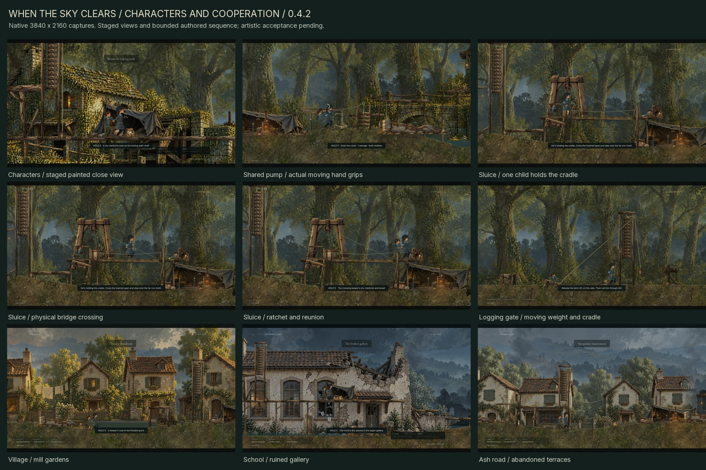

# When the Sky Clears

A painted, side-scrolling survival game about two children holding on to each other through displacement, ruined places, and the first signs of renewal.

Guide the older child, keep her companion close, and find shelter for both. Environmental problems and survival decisions shape the route: climb a machine to set it moving, find a dry way above a listening post, or save a scarce piece of salvage and cross cold water quietly. Food, warmth, medicine, and salvage are finite. Low cover requires crouching; exposed crossings require timing. Shared lifting, searching, repairs, and rest take time while the world keeps moving.



## Play

Download the verified [v0.4.2 Windows ZIP](https://github.com/SingSongScreamAlong/WhenTheSkyClears/releases/download/v0.4.2/When_The_Sky_Clears_Windows_v0.4.2.zip) or [editable-source ZIP](https://github.com/SingSongScreamAlong/WhenTheSkyClears/releases/download/v0.4.2/When_The_Sky_Clears_Editable_Source_v0.4.2.zip). Extract a Windows package and run **When the Sky Clears.exe**; standalone play needs neither Godot nor Python. Source opens in Godot 4.6 Standard. The [v0.4.1 release](docs/releases/v0.4.1.md) remains preserved. The earlier [v0.4.0 Windows ZIP](https://github.com/SingSongScreamAlong/WhenTheSkyClears/releases/download/v0.4.0/When_The_Sky_Clears_Windows_v0.4.0.zip) and [source ZIP](https://github.com/SingSongScreamAlong/WhenTheSkyClears/releases/download/v0.4.0/When_The_Sky_Clears_Editable_Source_v0.4.0.zip) remain available.

Use [`game/PLAY.cmd`](game/PLAY.cmd) to launch the full journey from a prepared checkout. [`game/MILL_PLAYTEST.cmd`](game/MILL_PLAYTEST.cmd) opens the mill directly in an isolated, unsaved playtest (`-- --mill-preview`). [`game/FREIGHT_CROSSING.cmd`](game/FREIGHT_CROSSING.cmd) opens a separate freight rehearsal (`-- --freight-crossing`) combining supply searches, shelter, stealth, traversal, and shared work. Its own save keeps the main journey intact. Normal campaign progress uses `journey_v4.json` in the separate `WhenTheSkyClears/v040` Godot user-data directory; earlier saves are preserved.

[`game/CANAL_PLAYTEST.cmd`](game/CANAL_PLAYTEST.cmd) (`-- --canal-preview`) starts an isolated, unsaved canal approach with no salvage. Search the existing tool roll before choosing between the pump and raised route. The full campaign remains compatible with v0.4.0 saves.

[`game/SLUICE_PLAYTEST.cmd`](game/SLUICE_PLAYTEST.cmd) (`-- --sluice-preview`) opens the new woods footbridge as an isolated, unsaved rehearsal. It is included in the v0.4.2 Windows package.

**On macOS:** install Godot 4.6 stable Standard, import `game/project.godot`, and run with F5. Python, .NET, Windows executables, and external runtime asset downloads are unnecessary for editor play. See [macOS setup and verification limits](docs/MACOS.md); a Mac runtime test is not claimed here.

The current build uses Godot's Vulkan Mobile renderer. The source checkout contains editable game assets and code; packaged executables are distributed through Releases.

| Keyboard | Action |
| --- | --- |
| A / D or arrow keys | Move |
| Space / W / Up | Jump |
| Shift | Run |
| S / Down | Crouch |
| Hold E | Search, work, or rest |
| Hold E + move against a crate | Push |
| Q | Ask the companion to wait low / call him |
| H | Use medicine |
| Tab | Pack and objective |
| R | Recover at the checkpoint |
| Esc / F11 / M | Pause / fullscreen / mute |

Controller: left stick or D-pad to move, A to jump, B to crouch, hold X to work, Y to wait/call, RB to run, Back for the pack, and Start to pause.

## Development pass 0.4.2

The new optional woods puzzle asks both children to operate a real counterweighted footbridge. Bring the boy onto the near cradle, ask him to wait with **Q**, cross after the span settles, and step onto the far ratchet. His weight holds the bridge while the other child crosses; the ratchet then lets him follow. Calling too soon releases the cradle and the bridge returns above the safe lower road. The keeper's medicine is finite and gated by the actual latch. This encounter uses the existing woods route; the five-chapter journey remains **79,200 world units**.

The girl now has a dedicated painted coat and sleeve/boot atlas, preserving her established face, hair and blue ribbon. Work has distinct poses for pumping, bracing, clearing, searching, shelter and balancing. Both children's hands follow the actual moving pump grips; pressure-cradle balance responds to physical contact and releases when a child walks away. Turn follow-through, landing anticipation, cold hands and quiet care develop their performance between hazards. The native work fixture measured maximum moving-grip errors of 1.091 pixels for the girl and 1.045 for the boy, with zero stationary body drift during that fixture. The staged normal-speed review is linked below; artistic acceptance remains separate.

Logging gates now lift gradually with their collision bodies, ropes and opposed counterweights. A released gate arrests above a child beneath it. Painted pressure cradles, pulleys, timber supports and ratchets share the mechanism's state. Generic barriers use timber slats, iron straps and guides; nearby grass responds to the children. The tent's painted material clarity remains the benchmark for faces, cloth, props and terrain.

The established journey runs from the village through woods, a camp and railway station, a flooded school, and an ash garden. Woods and school forks offer cold quiet water, a shared salvage-powered pump, or a secured upper climb. Eighteen timed hazard lanes include two sound-sensitive listening posts. Food, salvage and medicine are finite; shared work, repairs and rest demand time and proximity. The physical mill still connects its bridge, fence, breakaway wheel, tether and gate. Its rolling wheel can hurt a child left ahead of it.

This pass retains the v0.4.1 painted supply props, partial cache contents, animated pump and draining sluice, regional staging, mill feedback, planted-foot movement, and pause/interruption rules. The main campaign remains compatible with v0.4.0 saves. Authored interactive situations and the player's decisions drive the journey.

The [v0.4.2 notes](docs/releases/v0.4.2.md) and [development instructions](game/DEVELOPMENT_v0.4.2.txt) describe the implementation. The image above selects nine views from **16 verified native 4K captures**, including the actual wait/crossing/reunion sequence. The [character craft review](game/evidence/v042/WTSC_Character_Craft_Review_v042.mp4) and [sluice sequence](game/evidence/v042/WTSC_Sluice_Playthrough_v042.mp4) are labelled, silent native footage. The [earlier art comparison](game/evidence/v040/ART_READABILITY_BEFORE_AFTER.jpg), original paintings and exact ImageGen prompts remain preserved.

This is an evolving development game. AAA quality remains a production target; bespoke acting, animation transitions, world craft, sound design, human balancing and user artistic acceptance remain active work.

## Edit and build

1. Install **Godot 4.6 Standard** and import [`game/project.godot`](game/project.godot).
2. Run the project with F6 from `scenes/main.tscn`, or F5 for the project.

Editor play needs no export templates. To build the Windows package with the portable tools, run these commands from the repository root:

```sh
python game/tools/setup_godot.py
python game/tools/build_v042.py export
```

The setup helper downloads the official editor and Windows export templates and checks their recorded SHA-512 values. The export helper temporarily selects those portable templates and v0.4.2 product metadata, restores the checked-in preset byte for byte, then records the source and executable identity. Python is needed for development helpers, not for the game itself. Downloaded engines and generated import caches are not committed.

For manual editor or command-line exports, install matching Godot 4.6 export templates through the editor. The checked-in preset keeps its custom-template fields empty. Example commands with `godot` pointing to your editor:

```sh
godot --editor --path game
godot --headless --path game --import
godot --headless --path game --export-release "Windows Desktop" /absolute/output/WhenTheSkyClears.exe
```

Create the output directory before a manual export. See the [repository guide](docs/REPOSITORY.md) for the Windows workflow and evidence index, and [`game/SOURCE_SETUP.txt`](game/SOURCE_SETUP.txt) for the previously distributed source-package notes.

## Project layout

| Path | Contents |
| --- | --- |
| `game/scripts/` | Character controller, survival, encounters, rendering, HUD, and QA scenarios |
| `game/levels/` | Five authored JSON chapters |
| `game/scenes/` | Native Godot scenes |
| `game/assets/` | Runtime paintings, characters, props, motion data, fonts, and audio |
| `game/tools/` | Setup, level-authoring, packaging, and verification helpers |
| `game/previous/` | Preserved prior source and level data used by development tools |
| `game/evidence/` | Selected reports, manifests, and visual reviews |
| `docs/` | Repository setup, original story reference, and asset-source documentation |

## Verification

The v0.4.2 executable passed **431 native functional checks across 14 suites**, including two-child footbridge cooperation, rendered work contacts and pressure-gate physics. Its identity freezes **157 runtime files**. All **16 fresh native 3840 × 2160 captures** passed with a successful wait/crossing/reunion state report. A separate **27/27 source animation fixture** passed against the frozen source and is excluded from that native total. Continuous traversal completed **all five chapters in 730.45 simulated seconds**, with **one checkpoint recovery**, final health 100 and no failure. This is an automated route result, not measured human playtime.

Run source scenarios into separate evidence tags:

```sh
python game/tools/build_v042.py test sluice-checks --source --tag source_sluice
python game/tools/build_v042.py test craft-checks --source --tag source_craft
python game/tools/build_v042.py test world-craft-checks --source --tag source_world
```

[`build_v042.py`](game/tools/build_v042.py) provides independent `export`, `test`, `verify` and `package` operations. After export, run `test all`, then `test capture`; `verify` writes nothing, and `package` writes separate v0.4.2 ZIPs. Source and executable hashes, UID sidecars, fresh report/capture hashes and per-frame recording inventories keep results tied to their own invocation. The separate source animation fixture overlaps baseline checks and stays outside the native functional total.

The silent [craft movie](game/evidence/v042/WTSC_Character_Craft_Review_v042.mp4) passed full decode and exact frame-count validation at **1440 × 810, 30 fps, 686 frames / 22.8667 seconds**. The [sluice movie](game/evidence/v042/WTSC_Sluice_Playthrough_v042.mp4) passed the same checks at **313 frames / 10.4333 seconds**. Their [craft](game/evidence/v042/craft_movie_validation.json) and [sluice](game/evidence/v042/sluice_movie_validation.json) records bind every source frame and invocation to the exact native executable. The craft study stages separate acting situations; the sluice uses an authored starting fixture with earlier hazards disabled, then native input and physical contacts for the successful sequence. Targeted fixtures, staged acting, uninterrupted campaign navigation and human playtesting have different scopes.

The preserved [v0.4.1 manifest](game/evidence/v041/DELIVERY_MANIFEST_v041.json) records **386 native functional checks**, a separate **27-check source animation fixture**, **12 fresh native 4K captures**, and all five chapters completed in **730.45 simulated seconds with one checkpoint recovery**. Its silent [mill movie](game/evidence/v041/WTSC_Mill_Playthrough_v041.mp4) fully decoded at 1440 × 810, 30 fps and 540 frames / 18 seconds. Those results belong to v0.4.1, and the simulated traversal time is not measured human playtime. The earlier [v0.4.0 evidence](game/evidence/v040/DELIVERY_MANIFEST_v040.json) and packages remain available.

## Artwork and licenses

See [asset sources and provenance](docs/ASSET_SOURCES.md). Runtime assets retain their available source receipts and third-party licenses. Kenney footsteps are CC0; bundled fonts retain their SIL Open Font Licenses; Godot is MIT licensed. Quaternius models and animation were acquired as development references; the raw vendor archives and unused 3D reference libraries are not redistributed as part of the playable game's source tree.

Generated paintings include their recorded prompts and provenance beside the assets, including the [new girl clothing atlas](game/assets/characters/girl_cloth_PROVENANCE_v042.json), [counterweight components](game/assets/props/Counterweight_Parts_PROVENANCE_v042.json), [six-prop interaction atlas](game/assets/props/Interaction_Props_PROVENANCE_v041.json), [canal layer](game/assets/environments/Canal_PROVENANCE_v040.txt), [mill background](game/assets/environments/Mill_Background_PROVENANCE_v040.txt), [separate mill parts](game/assets/props/Mill_Parts_PROVENANCE_v040.txt), [railway layer](game/assets/environments/Rail_Yard_PROVENANCE_v030.txt), and [survival prop atlas](game/assets/props/PROVENANCE_v020.txt).

No blanket open-source license is granted for this repository. Rights to original game code, story, and artwork remain with their owner; third-party materials retain their own license terms.
