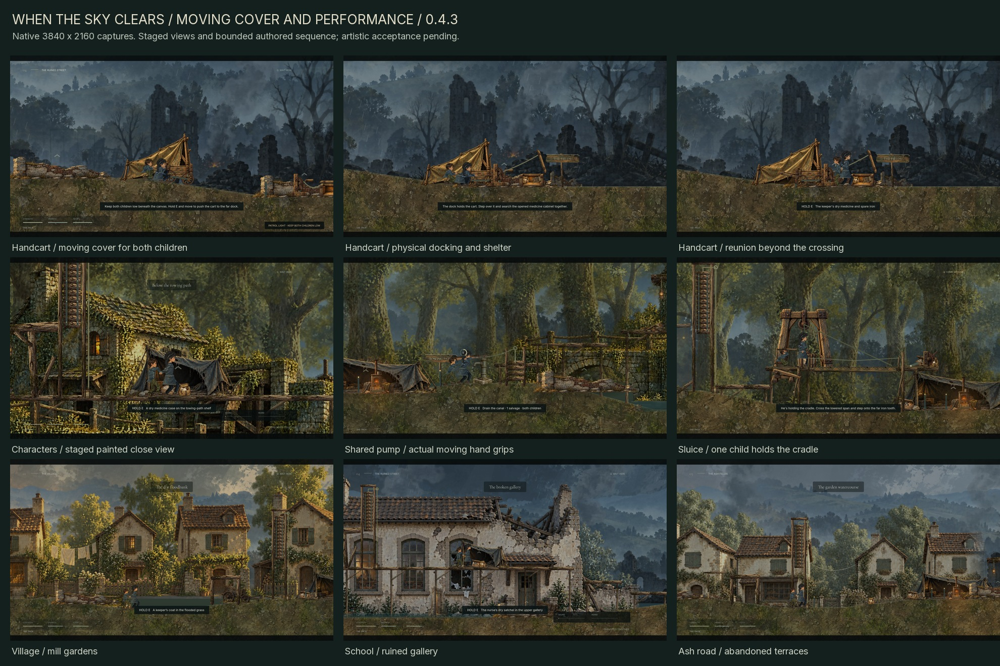

# When the Sky Clears

A painted, side-scrolling survival game about two children holding on to each other through displacement, ruined places, and the first signs of renewal.

Guide the older child, keep her companion close, and find shelter for both. Environmental problems and survival decisions shape the route: climb a machine to set it moving, find a dry way above a listening post, or save a scarce piece of salvage and cross cold water quietly. Food, warmth, medicine, and salvage are finite. Low cover requires crouching; exposed crossings require timing. Shared lifting, searching, repairs, and rest take time while the world keeps moving.



## Play

Download the verified [v0.4.3 Windows ZIP](https://github.com/SingSongScreamAlong/WhenTheSkyClears/releases/download/v0.4.3/When_The_Sky_Clears_Windows_v0.4.3.zip) or [editable-source ZIP](https://github.com/SingSongScreamAlong/WhenTheSkyClears/releases/download/v0.4.3/When_The_Sky_Clears_Editable_Source_v0.4.3.zip). Extract a Windows package and run **When the Sky Clears.exe**; standalone play needs neither Godot nor Python. Source opens in Godot 4.6 Standard. The [v0.4.2](docs/releases/v0.4.2.md) and [v0.4.1](docs/releases/v0.4.1.md) releases remain preserved. The earlier [v0.4.0 Windows ZIP](https://github.com/SingSongScreamAlong/WhenTheSkyClears/releases/download/v0.4.0/When_The_Sky_Clears_Windows_v0.4.0.zip) and [source ZIP](https://github.com/SingSongScreamAlong/WhenTheSkyClears/releases/download/v0.4.0/When_The_Sky_Clears_Editable_Source_v0.4.0.zip) remain available.

Use [`game/PLAY.cmd`](game/PLAY.cmd) to launch the full journey from a prepared checkout. [`game/MILL_PLAYTEST.cmd`](game/MILL_PLAYTEST.cmd) opens the mill directly in an isolated, unsaved playtest (`-- --mill-preview`). [`game/FREIGHT_CROSSING.cmd`](game/FREIGHT_CROSSING.cmd) opens a separate freight rehearsal (`-- --freight-crossing`) combining supply searches, shelter, stealth, traversal, and shared work. Its own save keeps the main journey intact. Normal campaign progress uses `journey_v4.json` in the separate `WhenTheSkyClears/v040` Godot user-data directory; earlier saves are preserved.

[`game/CANAL_PLAYTEST.cmd`](game/CANAL_PLAYTEST.cmd) (`-- --canal-preview`) starts an isolated, unsaved canal approach with no salvage. Search the existing tool roll before choosing between the pump and raised route. The full campaign remains compatible with v0.4.0 saves.

[`game/SLUICE_PLAYTEST.cmd`](game/SLUICE_PLAYTEST.cmd) (`-- --sluice-preview`) opens the new woods footbridge as an isolated, unsaved rehearsal. It is included in the v0.4.2 Windows package.

[`game/TROLLEY_PLAYTEST.cmd`](game/TROLLEY_PLAYTEST.cmd) (`-- --trolley-preview`) opens the new school handcart rehearsal from a prepared v0.4.3 checkout. The launcher is included in the v0.4.3 Windows package. Mill, canal, sluice and trolley previews retain sound, pause on focus loss and keep campaign saves untouched.

**On macOS:** install Godot 4.6 stable Standard, import `game/project.godot`, and run with F5. Python, .NET, Windows executables, and external runtime asset downloads are unnecessary for editor play. See [macOS setup and verification limits](docs/MACOS.md); a Mac runtime test is not claimed here.

The current build uses Godot's Vulkan Mobile renderer. The source checkout contains editable game assets and code; packaged executables are distributed through Releases.

| Keyboard | Action |
| --- | --- |
| A / D or arrow keys | Move |
| Space / W / Up | Jump |
| Shift | Run |
| S / Down | Crouch |
| Hold E | Search, work, or rest |
| Hold E + move against a crate or cart | Push |
| Q | Ask the companion to wait low / call him |
| H | Use medicine |
| Tab | Pack and objective |
| R | Recover at the checkpoint |
| Esc / F11 / M | Pause / fullscreen / mute |

Controller: left stick or D-pad to move, A to jump, B to crouch, hold X to work, Y to wait/call, RB to run, Back for the pack, and Start to pause.

## Development pass 0.4.3

The school now has an optional moving shelter: a real handcart with a canvas screen, rotating wheels, parking brake, dock and hinged medicine hatch. Keep both children crouched beneath its cloth and **hold E while moving against the cart**. Coverage is checked for each child's actual position, height and floor contact. Release the handle to brake; push into the far dock to catch its ratchet and open the physical lid. Bring both children to search **one medicine and one salvage**, then jump past the cabinet and raised lid. The original static-cover and timed route remains available.

Normal close now stops active audio, releases its streams and allows a short asynchronous drain before the engine exits. The cart, hatch and child poses hold during pause. Recovery resets an unsolved cart; a solved dock and spent/partial cache follow the campaign's saved progress. The right-hinged lid, dock stop and cabinet remain real obstacles with an actual exit route. The native trolley checks exercise physical pushing, cover, pause, recovery, persistence and exit.

The boy gains dedicated painted jacket, sleeve and trouser material while retaining his established face, silhouette and costume. Sleeves, hands and collars use softer contours; the girl's ribbon reuses its original painted detail. Crouch/rise and turn poses carry weight, while feet stay grounded and body/cloth settle through recovery. Actual warnings drive a protective reach toward the crouched companion; quiet safe idle avoids repeating that gesture. The cart grip drives the pushing hands, and released or paused contact retains a coherent pose. Existing interaction-prop mipmaps now improve their appearance at small screen sizes.

The established **79,200-unit, five-chapter journey** remains: village, woods, camp/railway, flooded school and ash garden. Food, warmth, medicine and salvage remain finite. Route choices, low cover, timed listening lanes, shelter and shared work still demand protection for both children. The earlier woods footbridge needs one child on its cradle while the other catches the far ratchet; the mill's breakaway wheel can hurt a child left ahead of it.

The [v0.4.3 notes](docs/releases/v0.4.3.md) and [development instructions](game/DEVELOPMENT_v0.4.3.txt) describe the implementation. The image above selects nine views from **19 verified native 4K captures**. The labelled [character performance](game/evidence/v043/WTSC_Character_Performance_Review_v043.mp4) and [trolley sequence](game/evidence/v043/WTSC_Trolley_Playthrough_v043.mp4) movies now bind to the frozen export. Final native verification passed; the prior [v0.4.2 release](docs/releases/v0.4.2.md) remains preserved.

AAA quality remains a production target. Bespoke acting, animation transitions, world craft, sound design, human balancing and user artistic acceptance remain active work. Original paintings and exact generation prompts stay preserved.

## Edit and build

1. Install **Godot 4.6 Standard** and import [`game/project.godot`](game/project.godot).
2. Run the project with F6 from `scenes/main.tscn`, or F5 for the project.

Editor play needs no export templates. To build the Windows package with the portable tools, run these commands from the repository root:

```sh
python game/tools/setup_godot.py
python game/tools/build_v043.py export
```

The setup helper downloads the official editor and Windows export templates and checks their recorded SHA-512 values. The export helper temporarily selects those portable templates and v0.4.3 product metadata, restores the checked-in preset byte for byte, then records the source and executable identity. Python is needed for development helpers, not for the game itself. Downloaded engines and generated import caches are not committed.

For manual editor or command-line exports, install matching Godot 4.6 export templates through the editor. The checked-in preset keeps its custom-template fields empty. Example commands with `godot` pointing to your editor:

```sh
godot --editor --path game
godot --headless --path game --import
godot --headless --path game --export-release "Windows Desktop" /absolute/output/WhenTheSkyClears.exe
```

Create the output directory before a manual export. See the [repository guide](docs/REPOSITORY.md) for the Windows workflow and evidence index, and [`game/SOURCE_SETUP.txt`](game/SOURCE_SETUP.txt) for the previously distributed source-package notes.

## Project layout

| Path | Contents |
| --- | --- |
| `game/scripts/` | Character controller, survival, encounters, rendering, HUD, and QA scenarios |
| `game/levels/` | Five authored JSON chapters |
| `game/scenes/` | Native Godot scenes |
| `game/assets/` | Runtime paintings, characters, props, motion data, fonts, and audio |
| `game/tools/` | Setup, level-authoring, packaging, and verification helpers |
| `game/previous/` | Preserved prior source and level data used by development tools |
| `game/evidence/` | Selected reports, manifests, and visual reviews |
| `docs/` | Repository setup, original story reference, and asset-source documentation |

## Verification

The final v0.4.3 executable passed **481 native functional checks across 16 suites**. A separate **27/27 source animation fixture** passed against the frozen source and stays outside that total. The [export identity](game/evidence/v043/EXPORT_IDENTITY.json) records **169 runtime files**. Continuous traversal completed **all five chapters in 730.4167 simulated seconds**, with **one checkpoint recovery**, final health 100 and no failure. Simulated traversal time is not measured human playtime.

The trolley and performance checks exercise independent child exposure, held physical pushing, parking, dock/hatch collision, pause, save/recovery, guarded acting and moving hand contact. The performance recording passes 22 checks: its 19 ordinary checks plus 3 over the complete rendered push/release. These scopes overlap and are not added together.

Run source diagnostics into separate tags:

```sh
python game/tools/build_v043.py test trolley-checks --source --tag source_trolley
python game/tools/build_v043.py test performance-checks --source --tag source_performance
```

[`build_v043.py`](game/tools/build_v043.py) provides independent `export`, `test`, `verify` and `package` operations. After runtime freeze/export, run `test all` and `test capture`; `verify` writes nothing, and `package` writes separate v0.4.3 ZIPs. The source animation fixture overlaps baseline movement checks and stays outside the native total. All runtime assets and UID sidecars belong to the frozen source identity.

All **19 fresh native 3840 × 2160 captures** passed, including successful sluice and trolley sequence reports. The silent [performance movie](game/evidence/v043/WTSC_Character_Performance_Review_v043.mp4) passed full decode at **1440 × 810 / 30 fps / 522 frames / 17.4 seconds**; the [trolley movie](game/evidence/v043/WTSC_Trolley_Playthrough_v043.mp4) passed at **530 frames / 17.6667 seconds**, with the same size/rate. Their [performance](game/evidence/v043/performance_movie_validation.json) and [trolley](game/evidence/v043/trolley_movie_validation.json) records bind every source frame and invocation to the exact executable. The performance recording also passes three render-time checks over the complete push/release. Both are labelled bounded fixtures; setup and preparation are excluded. Targeted encounters, staged acting, continuous navigation and human playtesting have different scopes.

The preserved [v0.4.2 manifest](game/evidence/v042/DELIVERY_MANIFEST_v042.json) records **431 native functional checks**, a separate **27/27 source animation fixture**, **157 runtime files**, **16 fresh native 4K captures**, and all five chapters completed in **730.45 simulated seconds with one checkpoint recovery**, final health 100 and no failure. Its silent [craft](game/evidence/v042/WTSC_Character_Craft_Review_v042.mp4) and [sluice](game/evidence/v042/WTSC_Sluice_Playthrough_v042.mp4) movies passed full decode at 1440 × 810 / 30 fps, respectively 686 and 313 frames. These results belong to v0.4.2, and simulated traversal time is not measured human playtime. [v0.4.1](docs/releases/v0.4.1.md) and [v0.4.0](docs/releases/v0.4.0.md) remain available.

## Artwork and licenses

See [asset sources and provenance](docs/ASSET_SOURCES.md). Runtime assets retain their available source receipts and third-party licenses. Kenney footsteps are CC0; bundled fonts retain their SIL Open Font Licenses; Godot is MIT licensed. Quaternius models and animation were acquired as development references; the raw vendor archives and unused 3D reference libraries are not redistributed as part of the playable game's source tree.

Generated paintings include their recorded prompts and provenance beside the assets, including the [new boy cloth](game/assets/characters/boy_cloth_v043.provenance.json), [trolley parts](game/assets/props/Trolley_Parts_v043.provenance.json), [girl clothing atlas](game/assets/characters/girl_cloth_PROVENANCE_v042.json), [counterweight components](game/assets/props/Counterweight_Parts_PROVENANCE_v042.json), [six-prop interaction atlas](game/assets/props/Interaction_Props_PROVENANCE_v041.json), [canal layer](game/assets/environments/Canal_PROVENANCE_v040.txt), [mill background](game/assets/environments/Mill_Background_PROVENANCE_v040.txt), [separate mill parts](game/assets/props/Mill_Parts_PROVENANCE_v040.txt), [railway layer](game/assets/environments/Rail_Yard_PROVENANCE_v030.txt), and [survival prop atlas](game/assets/props/PROVENANCE_v020.txt).

No blanket open-source license is granted for this repository. Rights to original game code, story, and artwork remain with their owner; third-party materials retain their own license terms.
