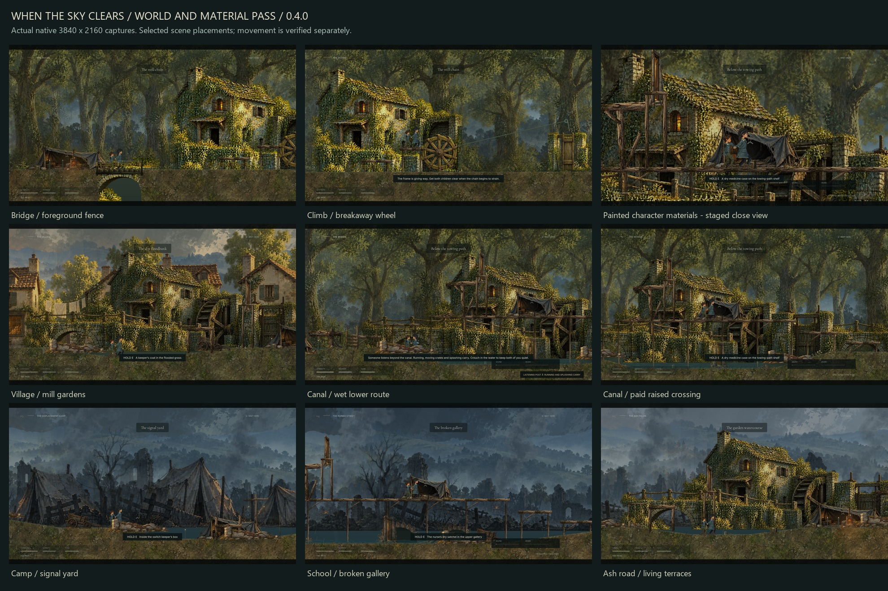

# When the Sky Clears

A painted, side-scrolling survival game about two children holding on to each other through displacement, ruined places, and the first signs of renewal.

Guide the older child, keep her companion close, and find shelter for both. Environmental problems and survival decisions shape the route: climb a machine to set it moving, find a dry way above a listening post, or save a scarce piece of salvage and cross cold water quietly. Food, warmth, medicine, and salvage are finite. Low cover requires crouching; exposed crossings require timing. Shared lifting, searching, repairs, and rest take time while the world keeps moving.



## Play

The **v0.4.0 source is undergoing final native verification**. Its planned Windows package is **When_The_Sky_Clears_Windows_v0.4.0.zip** on the [v0.4.0 release page](https://github.com/SingSongScreamAlong/WhenTheSkyClears/releases/tag/v0.4.0). The previous [v0.3.0 release](https://github.com/SingSongScreamAlong/WhenTheSkyClears/releases/tag/v0.3.0) remains available. Extract a Windows package and run **When the Sky Clears.exe**. Standalone builds do not require Godot or Python.

Use [`game/PLAY.cmd`](game/PLAY.cmd) to launch the full journey from a prepared checkout. [`game/MILL_PLAYTEST.cmd`](game/MILL_PLAYTEST.cmd) opens the mill directly in an isolated, unsaved playtest (`-- --mill-preview`). [`game/FREIGHT_CROSSING.cmd`](game/FREIGHT_CROSSING.cmd) opens a separate freight rehearsal (`-- --freight-crossing`) combining supply searches, shelter, stealth, traversal, and shared work. Its own save keeps the main journey intact. Normal campaign progress uses `journey_v4.json` in the separate `WhenTheSkyClears/v040` Godot user-data directory; earlier saves are preserved.

**On macOS:** install Godot 4.6 stable Standard, import `game/project.godot`, and run with F5. Python, .NET, Windows executables, and external runtime asset downloads are unnecessary for editor play. See [macOS setup and verification limits](docs/MACOS.md); a Mac runtime test is not claimed here.

The current build uses Godot's Vulkan Mobile renderer. The source checkout contains editable game assets and code; packaged executables are distributed through Releases.

| Keyboard | Action |
| --- | --- |
| A / D or arrow keys | Move |
| Space / W / Up | Jump |
| Shift | Run |
| S / Down | Crouch |
| Hold E | Search, work, or rest |
| Hold E + move against a crate | Push |
| Q | Ask the companion to wait low / call him |
| H | Use medicine |
| Tab | Pack and objective |
| R | Recover at the checkpoint |
| Esc / F11 / M | Pause / fullscreen / mute |

Controller: left stick or D-pad to move, A to jump, B to crouch, hold X to work, Y to wait/call, RB to run, Back for the pack, and Start to pause.

## Development build 0.4.0

Five chapters travel from the village through woods, a camp and railway station, a flooded school, and an ash garden. The authored route now spans **79,200 world units**, up from 56,000. Two new physical forks offer distinct paths through the woods canal and school arcade: stay low and quiet in cold water, spend one salvage on a shared pump, or climb above the listening lane and spend salvage to secure the upper passage. Dry food and medicine reward the high route; both children must get through it.

The woods mill connects its bridge, climbable fence, breakaway wheel, tether, and blocked gate into one physical encounter. A child standing on the wheel loads the frame. Its warning gives both children time to retreat before the wheel breaks free and rolls. The wheel's actual travel raises the gate; an interaction button cannot skip the sequence. A child left ahead of it can be hurt.

Eighteen timed hazard lanes, including two sound-sensitive listening posts, join shared lifts, debris clearing, optional braces, shelter repairs, moving lights, and crosswinds. The pack holds four food portions, three salvage pieces, and two medicines. World caches are finite, and optional rewards compete with the time, effort, and supplies spent reaching them. These are authored interactive situations; the game does not claim that every painted object is interactive.

The characters use drawn silhouettes, articulated limbs, planted feet, companion gestures, cloth follow-through, and collision-aware climbing. This pass refines crouch transitions, standing clearance under low ceilings, turn braking, quiet settling, and boot placement on slopes. Layered paintings, foreground cover, and collision-matched terrain form the world.

The current art pass uses the painted tent's material clarity as its benchmark. Faces and clothing retain visible paint and fabric detail, with clearer skin, hair, and garment values. Material tints, softer contact shadows, and restrained environmental darkness bring characters, terrain, and props into the same painted world. Final rendered review and artistic acceptance remain separate from functional test results.

This is an evolving development build, **not a finished commercial game or an achieved AAA quality target**. Bespoke acting, animation transitions, terrain and prop craft, encounter depth, sound design, and human balancing remain active work.

Read the [changes and controls](game/DEVELOPMENT_v0.4.0.txt), [chapter design](game/JOURNEY_v0.4.0.txt), and [v0.4.0 release notes](docs/releases/v0.4.0.md). Earlier [v0.3.0 notes](game/DEVELOPMENT_v0.3.0.txt) and releases remain available.

## Edit and build

1. Install **Godot 4.6 Standard** and import [`game/project.godot`](game/project.godot).
2. Run the project with F6 from `scenes/main.tscn`, or F5 for the project.

Editor play needs no export templates. To build the Windows package with the portable tools, run these commands from the repository root:

```sh
python game/tools/setup_godot.py
python game/tools/export_v040.py
```

The setup helper downloads the official editor and Windows export templates and checks their recorded SHA-512 values. The export helper temporarily selects those portable templates for the Windows export, restores the preset's empty custom-template fields, then records the source and executable identity. Python is needed for development helpers, not for the game itself. Downloaded engines and generated import caches are not committed.

For manual editor or command-line exports, install matching Godot 4.6 export templates through the editor. The checked-in preset keeps its custom-template fields empty. Example commands with `godot` pointing to your editor:

```sh
godot --editor --path game
godot --headless --path game --import
godot --headless --path game --export-release "Windows Desktop" /absolute/output/WhenTheSkyClears.exe
```

Create the output directory before a manual export. See the [repository guide](docs/REPOSITORY.md) for the Windows workflow and evidence index, and [`game/SOURCE_SETUP.txt`](game/SOURCE_SETUP.txt) for the previously distributed source-package notes.

## Project layout

| Path | Contents |
| --- | --- |
| `game/scripts/` | Character controller, survival, encounters, rendering, HUD, and QA scenarios |
| `game/levels/` | Five authored JSON chapters |
| `game/scenes/` | Native Godot scenes |
| `game/assets/` | Runtime paintings, characters, props, motion data, fonts, and audio |
| `game/tools/` | Setup, level-authoring, packaging, and verification helpers |
| `game/previous/` | Preserved prior source and level data used by development tools |
| `game/evidence/` | Selected reports, manifests, and visual reviews |
| `docs/` | Repository setup, original story reference, and asset-source documentation |

## Verification

Final v0.4.0 verification is in progress, including the appended mill encounter. Begin with the [delivery manifest](game/evidence/v040/DELIVERY_MANIFEST_v040.json) and `game/evidence/v040/release_final/<scenario>/invocation.json` for the packaged build's identity, exit status, and results. Earlier passes do not establish a pass for a later build. Native full-journey navigation, targeted movement and encounter tests, and staged visual studies have separate scopes.

The retained v0.3.0 release passed **189 functional checks** and completed its automated journey in approximately **8 minutes 16 seconds**, with one checkpoint recovery. Those results belong to v0.3.0, not the expanded v0.4.0 route; they are not human playtime estimates.

Run an individual scenario against the source project:

```sh
godot --headless --path game --fixed-fps 60 -- --smoke
godot --headless --path game --fixed-fps 60 -- --survival
godot --headless --path game --fixed-fps 60 -- --encounters
godot --headless --path game --fixed-fps 60 -- --journey-checks
godot --headless --path game --fixed-fps 60 -- --side-routes
godot --headless --path game --fixed-fps 60 -- --movement-checks
godot --headless --path game --fixed-fps 60 -- --development-checks
godot --headless --path game --fixed-fps 60 -- --mill-checks
godot --headless --path game --fixed-fps 60 -- --crossing-checks
godot --headless --path game --fixed-fps 60 -- --traverse
```

[`qa_v040.py`](game/tools/qa_v040.py) records invocations, hashes, logs, and exit status; its portable-engine and release paths follow the Windows workspace layout. For example, run `python game/tools/qa_v040.py mill-checks` against the source or add `--release` for the exported v0.4.0 executable. [`export_v040.py`](game/tools/export_v040.py) imports, exports, and records build identity. Selected 4K captures use the actual renderer; character close views are staged. The [mill playthrough](game/evidence/v040/WTSC_Mill_Playthrough_v040.mp4) records native input and physics through that encounter, separately from full campaign traversal. Earlier movement movies remain labeled studies of their recorded versions. Automated checks and rendered captures do not establish artistic acceptance or replace human playtesting.

The expanded animation fixture is reported separately because it includes the baseline movement checks. [`package_v040.py`](game/tools/package_v040.py) verifies frozen source hashes, final executable evidence, rendered captures, movie decoding, and terrain results before writing the Windows and editable-source ZIPs. Use `--verify-only` for a check without writing delivery artifacts.

## Artwork and licenses

See [asset sources and provenance](docs/ASSET_SOURCES.md). Runtime assets retain their available source receipts and third-party licenses. Kenney footsteps are CC0; bundled fonts retain their SIL Open Font Licenses; Godot is MIT licensed. Quaternius models and animation were acquired as development references; the raw vendor archives and unused 3D reference libraries are not redistributed as part of the playable game's source tree.

Generated paintings include their recorded prompts and provenance beside the assets, including the [canal layer](game/assets/environments/Canal_PROVENANCE_v040.txt), [mill background](game/assets/environments/Mill_Background_PROVENANCE_v040.txt), [separate mill parts](game/assets/props/Mill_Parts_PROVENANCE_v040.txt), [railway layer](game/assets/environments/Rail_Yard_PROVENANCE_v030.txt), and [survival prop atlas](game/assets/props/PROVENANCE_v020.txt).

No blanket open-source license is granted for this repository. Rights to original game code, story, and artwork remain with their owner; third-party materials retain their own license terms.
